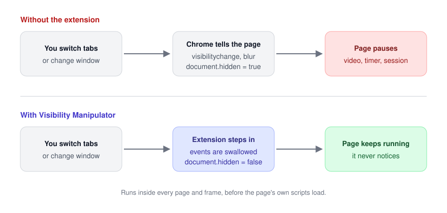
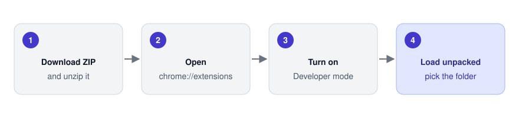
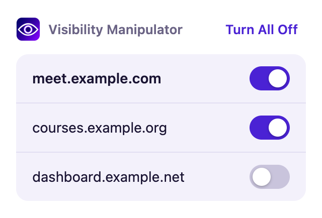

<p align="center">
  
</p>

<h1 align="center">Visibility Manipulator</h1>

<p align="center">A tiny Chrome extension that keeps pages active when you switch tabs or windows.</p>

<p align="center"><a href="README.tr.md">Türkçe</a></p>

Many pages watch whether you are looking at them. When you switch tabs, they pause the video, stop the timer, or mark you as away. Visibility Manipulator makes every page believe it is always visible and focused.



## Contents

- [Install](#install)
- [Use](#use)
- [Check that it works](#check-that-it-works)
- [Turn it off, update, or remove it](#turn-it-off-update-or-remove-it)
- [What it changes](#what-it-changes)
- [Limits](#limits)
- [Troubleshooting](#troubleshooting)
- [Privacy](#privacy)
- [Development](#development)
- [License](#license)

## Install

The extension is not on the Chrome Web Store. You load it from a folder, which takes about a minute.



1. **Download the code.** Get the ZIP from the [latest release](https://github.com/denizbarish/visibility-manipulator/releases/latest) and unzip it. Or clone the repository:
   ```bash
   git clone https://github.com/denizbarish/visibility-manipulator.git
   ```
2. **Open the extensions page.** Type `chrome://extensions` in the address bar and press Enter.
3. **Turn on Developer mode.** The switch is in the top-right corner of the page.
4. **Click Load unpacked** and select the `visibility-manipulator` folder (the one that contains `manifest.json`).

Visibility Manipulator now appears in your extension list. Keep the folder where it is: Chrome loads the extension from that location every time it starts.

**Supported browsers:** Chrome 111 or later, and other Chromium browsers such as Edge (`edge://extensions`), Brave (`brave://extensions`), and Arc. Firefox and Safari are not supported.

## Use

Once installed, the extension works on every site automatically.

1. Open the page you want to keep active (a meeting, a video, a course, a dashboard).
2. If the page was already open before you installed the extension, **reload it once**.
3. Switch to another tab or app. The page keeps running as if you were still looking at it.

### Choose which sites it runs on



Click the Visibility Manipulator icon in the toolbar. If you do not see the icon, click the puzzle icon and pin the extension.

The popup lists every site you have open, in any tab or window, with the site of the current tab first. You do not need to switch to a tab to change its site.

1. Turn the switch off for each site that should see real tab switches again. To switch off every listed site at once, click **Turn All Off**. The button then becomes **Turn All On**.
2. Click **Reload Pages**. Only the tabs whose setting changed are reloaded.

A site with several open tabs appears once, and its switch covers all of them. Each choice is remembered until you change it. Sites you open later start switched on.

The extension also works in incognito windows if you allow it: open `chrome://extensions`, click **Details** on Visibility Manipulator, and turn on **Allow in Incognito**.

## Check that it works

1. Open any website and press `F12` (or `Cmd+Option+J` on Mac) to open the console.
2. Paste this line and press Enter:
   ```js
   setInterval(() => console.log(document.visibilityState, document.hasFocus()), 2000);
   ```
3. Switch to another tab for a few seconds, then come back.

With the extension, every line reads `visible true`. Without it, you see `hidden false` for the time you were away.

## Turn it off, update, or remove it

All three happen on `chrome://extensions`:

| Goal | Action |
| --- | --- |
| Turn it off for some sites | Use the switches in the extension popup. See [Choose which sites it runs on](#choose-which-sites-it-runs-on). |
| Turn it off everywhere | Switch off the toggle on the Visibility Manipulator card, then reload open pages. |
| Update to a new version | Download the new code into the same folder (or run `git pull`), then click the reload icon on the card. |
| Remove it | Click **Remove** on the card. You can then delete the folder. |

## What it changes

| Page feature | Normal behavior | With the extension |
| --- | --- | --- |
| `document.hidden` | `true` when the tab is in the background | Always `false` |
| `document.visibilityState` | `hidden` in the background | Always `visible` |
| `document.hasFocus()` | `false` when the window loses focus | Always `true` |
| `visibilitychange` event | Fires on every tab switch | Never reaches the page |
| `blur` on the window | Fires when you leave the window | Never reaches the page |
| `mouseleave` on the document | Fires when the pointer leaves the page | Never reaches the page |
| `freeze` event | Fires when Chrome freezes the tab | Never reaches the page |
| `blur` on inputs and buttons | Fires when a field loses focus | Unchanged, forms keep working |

The script runs in every page and every frame (including embedded iframes) before the page's own scripts load, so the page never sees the real values. Sites you switched off are left untouched.

## Limits

- **Chrome still throttles background tabs.** Animations driven by `requestAnimationFrame` stop, and timers slow down to about one tick per second. No extension script can lift that. If a page still slows down, drag its tab out into a separate window and leave that window visible behind your other work.
- **Chrome can discard inactive tabs to save memory.** To prevent it, add the site under `chrome://settings/performance` in **Always keep these sites active**.
- **Server-side checks are out of reach.** If a site measures activity on its server (for example, by mouse movement or keystrokes sent over the network), this extension does not affect it.
- **The site switch follows each frame's own address.** If you switch off `a.com`, a frame from `b.com` embedded in it is still patched, and an `a.com` frame embedded in another site is not. Frames without an address of their own (such as `about:blank`) follow the page that created them.
- **The site switch ignores ports.** Switching off `localhost` covers `localhost:3000` and `localhost:5173` alike.
- **Chrome's own pages are excluded.** Extensions cannot run on `chrome://` pages or the Chrome Web Store.

## Troubleshooting

| Problem | Fix |
| --- | --- |
| The page still pauses | Reload the page. Pages opened before installation are not patched until reloaded. |
| Still pauses after reload | Check that the extension toggle is on at `chrome://extensions` and that the site switch in the popup is on. Then see [Limits](#limits): the page may depend on animation frames, so move it to its own window. |
| "Manifest file is missing or unreadable" | You selected the wrong folder. Pick the folder that directly contains `manifest.json`. |
| The extension disappeared after a restart | The folder was moved or deleted. Put it back, or load it again from its new location. |
| Chrome shows a "Disable developer mode extensions" prompt | This is normal for extensions loaded from a folder. Dismiss it. |
| A site behaves strangely | Turn the extension off, reload the page, and [open an issue](https://github.com/denizbarish/visibility-manipulator/issues) with the site address. |

## Privacy

The extension makes no network requests and collects no data. The list of sites you switched off is stored only in your browser.

It asks for three permissions:

| Permission | Why |
| --- | --- |
| Access to all sites | To add the script to every page you open. |
| `scripting` | To leave the script out of sites you switched off. |
| `storage` | To remember those sites. |

The code is a handful of small files. [`inject.js`](inject.js) is the only one that runs inside pages.

## Development

There is no build step. Edit `inject.js`, click the reload icon on the extension card at `chrome://extensions`, and reload the test page.

```
visibility-manipulator/
├── manifest.json   Extension definition (Manifest V3)
├── inject.js       The script injected into every page
├── sites.js        Switched-off site list and script registration
├── background.js   Registers the script on install and update
├── popup.*         The list of open sites and their switches
├── _locales/       English and Turkish strings
├── icons/          Extension icons
└── docs/           Images used in this guide
```

Issues and pull requests are welcome.

## License

[MIT](LICENSE)
