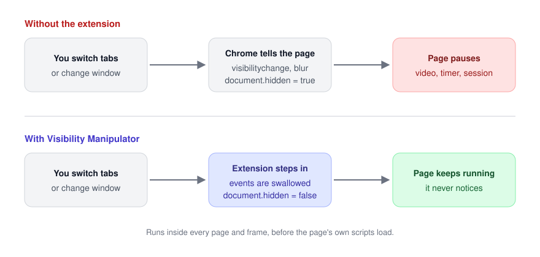
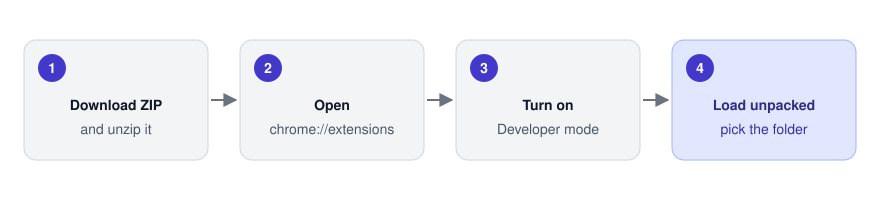

<p align="center">
  
</p>

<h1 align="center">Visibility Manipulator</h1>

<p align="center">Sekme ya da pencere değiştirdiğinizde sayfaların aktif kalmasını sağlayan küçük bir Chrome eklentisi.</p>

<p align="center"><a href="README.md">English</a></p>

Birçok sayfa, ona bakıp bakmadığınızı izler. Başka sekmeye geçtiğinizde videoyu duraklatır, sayacı durdurur ya da sizi "uzakta" sayar. Visibility Manipulator, her sayfanın kendisini hep görünür ve odakta sanmasını sağlar.



## İçindekiler

- [Kurulum](#kurulum)
- [Kullanım](#kullanım)
- [Çalıştığını doğrulama](#çalıştığını-doğrulama)
- [Kapatma, güncelleme, kaldırma](#kapatma-güncelleme-kaldırma)
- [Neyi değiştirir](#neyi-değiştirir)
- [Sınırlar](#sınırlar)
- [Sorun giderme](#sorun-giderme)
- [Gizlilik](#gizlilik)
- [Geliştirme](#geliştirme)
- [Lisans](#lisans)

## Kurulum

Eklenti Chrome Web Mağazası'nda değil. Bir klasörden yüklenir, yaklaşık bir dakika sürer.



1. **Kodu indirin.** GitHub sayfasında **Code**, ardından **Download ZIP** düğmesine tıklayın ve dosyayı açın. Ya da klonlayın:
   ```bash
   git clone https://github.com/denizbarish/visibility-manipulator.git
   ```
2. **Uzantılar sayfasını açın.** Adres çubuğuna `chrome://extensions` yazıp Enter'a basın.
3. **Geliştirici modunu açın.** Anahtar sayfanın sağ üst köşesindedir.
4. **Paketlenmemiş öğe yükle** (Load unpacked) düğmesine tıklayın ve `visibility-manipulator` klasörünü seçin (içinde `manifest.json` olan klasör).

Visibility Manipulator artık uzantı listenizde görünür. Klasörü yerinde bırakın: Chrome eklentiyi her açılışta o konumdan yükler.

**Desteklenen tarayıcılar:** Chrome 111 ve üzeri ile diğer Chromium tarayıcıları: Edge (`edge://extensions`), Brave (`brave://extensions`), Arc. Firefox ve Safari desteklenmez.

## Kullanım

Ayarlanacak bir şey yok. Eklenti kurulduktan sonra her sitede kendiliğinden çalışır.

1. Aktif kalmasını istediğiniz sayfayı açın (toplantı, video, kurs, pano).
2. Sayfa eklentiyi kurmadan önce açıktıysa **bir kez yenileyin**.
3. Başka bir sekmeye ya da uygulamaya geçin. Sayfa, hâlâ ona bakıyormuşsunuz gibi çalışmayı sürdürür.

Eklenti izin verirseniz gizli pencerelerde de çalışır: `chrome://extensions` sayfasında Visibility Manipulator kartındaki **Ayrıntılar**'a tıklayın ve **Gizli modda izin ver** seçeneğini açın.

## Çalıştığını doğrulama

1. Herhangi bir siteyi açın ve konsolu açmak için `F12` tuşuna (Mac'te `Cmd+Option+J`) basın.
2. Şu satırı yapıştırıp Enter'a basın:
   ```js
   setInterval(() => console.log(document.visibilityState, document.hasFocus()), 2000);
   ```
3. Birkaç saniyeliğine başka sekmeye geçin, sonra geri dönün.

Eklenti varken her satır `visible true` yazar. Eklenti yokken, uzakta olduğunuz süre için `hidden false` görürsünüz.

## Kapatma, güncelleme, kaldırma

Üçü de `chrome://extensions` sayfasında yapılır:

| Amaç | Yapılacak |
| --- | --- |
| Bir süreliğine kapatmak | Visibility Manipulator kartındaki anahtarı kapatın, açık sayfaları yenileyin. |
| Yeni sürüme güncellemek | Yeni kodu aynı klasöre indirin (ya da `git pull` çalıştırın), sonra karttaki yenile simgesine tıklayın. |
| Kaldırmak | Karttaki **Kaldır** düğmesine tıklayın. Ardından klasörü silebilirsiniz. |

## Neyi değiştirir

| Sayfa özelliği | Normal davranış | Eklentiyle |
| --- | --- | --- |
| `document.hidden` | Sekme arka plandayken `true` | Her zaman `false` |
| `document.visibilityState` | Arka planda `hidden` | Her zaman `visible` |
| `document.hasFocus()` | Pencere odağı kaybedince `false` | Her zaman `true` |
| `visibilitychange` olayı | Her sekme değişiminde tetiklenir | Sayfaya hiç ulaşmaz |
| Pencerede `blur` | Pencereden ayrılınca tetiklenir | Sayfaya hiç ulaşmaz |
| Belgede `mouseleave` | İmleç sayfadan çıkınca tetiklenir | Sayfaya hiç ulaşmaz |
| `freeze` olayı | Chrome sekmeyi dondurunca tetiklenir | Sayfaya hiç ulaşmaz |
| Girdi ve düğmelerde `blur` | Alan odağı kaybedince tetiklenir | Değişmez, formlar çalışır |

Betik her sayfada ve her çerçevede (gömülü iframe'ler dahil), sayfanın kendi betikleri yüklenmeden önce çalışır. Sayfa gerçek değerleri hiç görmez.

## Sınırlar

- **Chrome arka plan sekmelerini yine de kısar.** `requestAnimationFrame` ile çalışan animasyonlar durur, zamanlayıcılar saniyede yaklaşık bire düşer. Bunu hiçbir eklenti betiği aşamaz. Sayfa hâlâ yavaşlıyorsa sekmesini sürükleyip ayrı bir pencereye alın ve o pencereyi diğer işlerinizin arkasında görünür bırakın.
- **Chrome bellek kazanmak için etkin olmayan sekmeleri boşaltabilir.** Önlemek için siteyi `chrome://settings/performance` sayfasındaki **Bu siteleri her zaman etkin tut** listesine ekleyin.
- **Sunucu taraflı denetimlere etki etmez.** Site etkinliği kendi sunucusunda ölçüyorsa (örneğin ağ üzerinden gönderilen fare hareketi ya da tuş vuruşlarıyla), eklenti bunu değiştirmez.
- **Chrome'un kendi sayfaları kapsam dışıdır.** Eklentiler `chrome://` sayfalarında ve Chrome Web Mağazası'nda çalışamaz.

## Sorun giderme

| Sorun | Çözüm |
| --- | --- |
| Sayfa hâlâ duruyor | Sayfayı yenileyin. Kurulumdan önce açılan sayfalar yenilenene kadar etkilenmez. |
| Yeniledikten sonra da duruyor | `chrome://extensions` sayfasında eklenti anahtarının açık olduğunu kontrol edin. Sonra [Sınırlar](#sınırlar) bölümüne bakın: sayfa animasyon karelerine bağlı olabilir, ayrı pencereye alın. |
| "Manifest dosyası eksik veya okunamıyor" | Yanlış klasörü seçtiniz. İçinde doğrudan `manifest.json` bulunan klasörü seçin. |
| Eklenti yeniden başlatınca kayboldu | Klasör taşınmış ya da silinmiş. Geri koyun ya da yeni konumundan yeniden yükleyin. |
| Chrome "Geliştirici modundaki uzantıları devre dışı bırak" uyarısı gösteriyor | Klasörden yüklenen eklentilerde bu normaldir. Uyarıyı kapatın. |
| Bir site tuhaf davranıyor | Eklentiyi kapatın, sayfayı yenileyin ve site adresiyle birlikte [bir issue açın](https://github.com/denizbarish/visibility-manipulator/issues). |

## Gizlilik

Eklenti hiçbir izin istemez, ağ isteği yapmaz, veri toplamaz. İki küçük dosyadan oluşur: [`manifest.json`](manifest.json) ve [`inject.js`](inject.js). İkisini bir dakikada okuyabilirsiniz.

## Geliştirme

Derleme adımı yok. `inject.js` dosyasını düzenleyin, `chrome://extensions` sayfasında eklenti kartındaki yenile simgesine tıklayın ve test sayfasını yenileyin.

```
visibility-manipulator/
├── manifest.json   Eklenti tanımı (Manifest V3)
├── inject.js       Her sayfaya eklenen betik
├── icons/          Eklenti simgeleri
└── docs/           Bu rehberdeki görseller
```

Issue ve pull request'ler memnuniyetle karşılanır.

## Lisans

[MIT](LICENSE)
